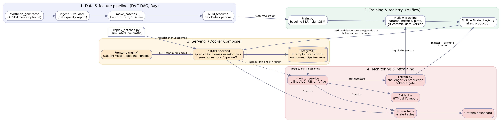

# QuizPulse - AIOps lifecycle for knowledge tracing

Predicts the probability that a student answers the next quiz question correctly, turns it into **topic mastery / weak topics**, recommends **next questions**, and keeps the model healthy with
**versioned data (DVC), tracking + registry (MLflow), serving (FastAPI, Docker Compose), monitoring (Prometheus, Grafana), drift detection (PSI + Evidently) and automatic gated retraining**.



## Quick start (Docker)
```bash
dvc repro                       # optional: builds data + features on the host (bootstrap does it otherwise)
docker compose up --build       # first run 3-6 min
```
| URL | |
|---|---|
| http://localhost:8080 | UI (student view + pipeline console) |
| http://localhost:8000/docs | API (Swagger) |
| http://localhost:5000 | MLflow |
| http://localhost:3000 | Grafana (no login) |
| http://localhost:9090 | Prometheus |

Demo (see `docs/STEP_BY_STEP_GUIDE.md` section 8):
```bash
pip install -r requirements-dev.txt
python scripts/replay_batches.py --batch 1 2 3 --student-fraction 0.4   # normal traffic
python scripts/replay_batches.py --batch 4 --student-fraction 0.4       # drifted week -> drift -> retrain -> new model served
```

## Run without Docker
```bash
python -m venv .venv && source .venv/bin/activate && pip install -r requirements-dev.txt
mlflow server --port 5000 --backend-store-uri sqlite:///mlflow.db --artifacts-destination ./mlartifacts --serve-artifacts &
export MLFLOW_TRACKING_URI=http://localhost:5000 DATABASE_URL=sqlite:///quizpulse.db
dvc repro && python -m src.models.register && python scripts/seed_history.py
uvicorn src.serving.app:app --port 8000 &
uvicorn src.monitoring.monitor_app:app --port 8100 &
(cd frontend && python -m http.server 8080)
```

## Layout
```
src/data        generator, ingest + validation, time-based batches
src/features    past-only features (Ray / pandas) + online features (same code)
src/models      train (baseline | LR | LightGBM), evaluate, register/promote, pyfunc wrapper
src/serving     FastAPI app, schemas, model loader (hot reload), mastery, Prometheus metrics
src/monitoring  performance monitor, drift (PSI + Evidently), monitor service (exporter + trigger)
src/retrain     check drift -> train -> compare -> promote
scripts/        replay_batches.py, seed_history.py, bootstrap.py, make_dashboard.py
frontend/       static UI (nginx), talks to the API only via REST
docker/         Dockerfiles, Prometheus rules, Grafana provisioning + dashboard
dvc.yaml params.yaml MLproject docker-compose.yml .github/workflows/ci.yml
docs/           HLD, LLD, test plan/report, user manual, step-by-step guide, viva prep, architecture
report/         project report
```
Tests: `pytest` (32 tests) - lint: `ruff check src tests scripts`.

## Documents
`docs/STEP_BY_STEP_GUIDE.md` (start here) | `docs/HLD.md` | `docs/LLD.md` | `docs/TEST_PLAN.md` | `docs/TEST_REPORT.md` | `docs/USER_MANUAL.md` | `docs/VIVA_PREP.md` | `report/REPORT.md` | `AI_DISCLOSURE.md`


