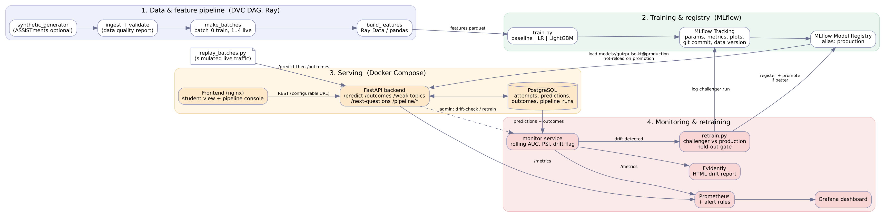

# QuizPulse - High-Level Design (HLD)

## 1. Problem and success metrics
EdTech platforms (the Sanrathi tie-in) store every quiz attempt but rarely turn it into feedback. QuizPulse predicts, from a
student's past attempts, the probability `p_correct` that the **next** question is answered correctly (binary knowledge tracing),
aggregates it into per-topic **mastery**, flags **weak topics** (mastery < 0.5) and recommends the **next questions**.

| Metric | Target | Where measured |
|---|---|---|
| AUC (main), log-loss, accuracy | best model >= baseline + 0.02 AUC | `src/models/train.py`, MLflow |
| Live AUC on delayed labels | stays within 0.04 of training AUC, else drift alert | `src/monitoring/performance_monitor.py`, Grafana |
| `/predict` latency | p95 < 100 ms (reference run: p50 13 ms, p95 19 ms, p99 36 ms, SQLite, 1 worker) | Prometheus histogram |
| Reproducibility | any model <- git commit + MLflow run id + data version | tags on every run/version |

The ML model is deliberately simple; the focus is the AIOps lifecycle around it (guideline: automation, reproducibility, CI,
monitoring, version control, environment parity).

## 2. Architecture blocks (what each box does and why it exists)
| Block | Tech | Responsibility | Why this choice |
|---|---|---|---|
| Data generator / ingest | Python, pandas | Create or load attempts, validate (schema, nulls, binary target, ordering), write a data-quality report | Public data (ASSISTments) is the realistic option; a generator lets us **inject controlled drift** |
| Batching | Python | Time-ordered split: `batch_0` = training weeks, `batch_1..4` = "new weeks" (last one drifted) | Split by time, never randomly -> no leakage |
| Feature pipeline | **Ray Data** (pandas switch) | Per-student past-only features, partitioned by student | Rubric requires Ray/Spark/K8s; students are independent -> trivially parallel |
| Data/CI orchestration | **DVC** (`dvc.yaml`, `params.yaml`) | DAG, caching, data versions, metrics | Guideline: CI/CD = DVC |
| Training + tracking | scikit-learn, LightGBM, **MLflow** | 3 models compared; params/metrics/plots/git commit/data hash logged | Lecture 3; reproducibility |
| Model registry | MLflow Registry, alias `production` | Versioning, promotion, rollback by moving the alias | Lecture 3 / Exercise 4 |
| Serving API | **FastAPI** + pyfunc model | `/predict`, `/outcomes`, `/weak-topics`, `/next-questions`, admin + pipeline endpoints | Lecture 10; typed contract (pydantic) |
| MLflow Serve | `mlflow models serve` | The same registered model exposed with MLflow's own REST server (optional compose profile) | Rubric: "MLflow for APIfication" |
| Operational store | **PostgreSQL** | `attempts` (history), `predictions`, `outcomes` (delayed labels), `pipeline_runs` (audit) | Online features and monitoring need a shared, durable store |
| Frontend | static HTML/JS in **nginx** | Student view and pipeline console; **only talks REST** to the API at a configurable URL | Rubric: strict loose coupling UI <-> backend |
| Monitoring | **Prometheus + Grafana** | API metrics (rate, latency, errors, prediction distribution, model version) + monitor metrics (rolling AUC, PSI, drift flag) | Lecture 9 |
| Drift + retrain | PSI (decision), **Evidently** (report), `retrain.py` | Detect drift -> train challenger -> compare with production on the same hold-out -> promote if better | Closes the loop automatically |
| Packaging | Docker, **Compose** | `frontend` and `api` are separate services; one backend image reused by api/monitor/mlflow/bootstrap | Environment parity (guideline) |
| CI | DVC DAG + GitHub Actions | lint, tests, pipeline, acceptance gate, image builds | Lecture 11 |

## 3. Key design decisions and rationale
1. **Online features = the same function as offline features.** `online_features()` calls `user_features()` on `history + target row`.
   A test (`test_offline_online_parity`) proves equality -> no training/serving skew.
2. **Features only from the past.** `shift(1)` style computations; test `test_no_leakage_a_label_only_affects_the_future`.
3. **Question difficulty from the DB at request time** (count/sum of earlier attempts) -> identical to the offline expanding statistic.
4. **Hot reload via the registry alias.** The API polls `models:/quizpulse-kt@production`; promotion = one alias move, rollback = move it back.
5. **Retrain gate.** Challenger and production are scored on the *same* time-ordered hold-out (most recent 40% of the recent window,
   never used for training). Promote only if AUC improves by >= `promotion_min_auc_delta` (0.002) **and** log-loss does not get worse.
   Rejected challengers still become registry versions (audit trail) but never get the alias.
6. **Drift decision with PSI, report with Evidently.** PSI is simple, explainable and unit-tested; Evidently provides the HTML for humans.
   `skill_attempts` is monitored through the stationary `cold_start` indicator because a raw counter grows for every student as time passes (this caused
   a false alarm during development - see report section 6). Reference = most recent part of training data (matured histories); after a retrain
   the reference becomes the regime that triggered it.
7. **Loose coupling.** UI and model engine communicate only through REST; `frontend/config.js` holds the API URL; CORS is enabled on the API.
8. **No cloud services** (guideline); everything runs locally in Docker.
9. **Security basics.** No secrets in code (DB URL via env), pydantic input validation, parameterised SQL. Encryption of data at rest/in transit
   is *not* implemented (local demo) - listed as a limitation and future work (TLS reverse proxy, Postgres SSL, MLflow auth).

## 4. Pipelines
**Batch (DVC DAG):** `generate -> ingest -> batches -> features (Ray) -> train -> test`.
**Online:** replay/clients -> `/predict` (history + question stats from Postgres, model from registry) -> log prediction -> `/outcomes` (label + new attempt).
**Operations loop (every 10 s in the monitor):** rolling AUC + PSI -> Prometheus gauges; on first drift detection -> full Evidently report + MLflow monitoring run +
pipeline_runs row -> (auto) `retrain()` -> promote -> API hot-reloads within `MODEL_POLL_SECONDS`.

## 5. Scalability and limits
* API is stateless (state in Postgres/MLflow) -> scale with more uvicorn workers/containers; feature building is ~3.5 ms/request.
* Ray feature stage scales to multi-million rows; at 50k rows its start-up overhead makes it slower than pandas (measured 3.5k vs 28k rows/s).
* Replay throughput ~55 rows/s (2 HTTP calls per row, SQLite/1 worker) - fine for demos, not a load test.
* Out of scope: Kubernetes, Kafka, real Sanrathi data (same `attempts` schema could be used), authentication, GPU models.
