# QuizPulse: An End-to-End AIOps Pipeline for Student Knowledge Tracing

**Author:** Mithilesh  
**Course:** DA3408 – AI Application Development with AIOps  
**Code:** https://github.com/mithilesh939/aiops_project  
**Date:** November 2026

> Image paths below assume this file is saved as `report/QuizPulse_Final_Report.md` inside the repository, with the screenshots in `screenshots/`.

## Abstract

QuizPulse is a working AI application for the Sanrathi EdTech platform. It predicts the probability that a student answers the next quiz question correctly, turns that into topic mastery and "what to practise next" advice, and keeps the model healthy in production. The system covers the whole lifecycle required by the course guidelines: versioned data and code (Git, DVC), a Ray-based feature pipeline, tracked experiments and a model registry (MLflow), a FastAPI service with a separate web front end, Prometheus/Grafana monitoring, drift detection, and an automatic retrain-and-promote loop. All services run as Docker containers. This report describes the design, the results we measured and the evidence collected from our own runs.

## 1. Problem and success criteria

Students answer many quiz questions, but neither they nor their teachers can easily see which topics are weak. We frame this as *knowledge tracing*: a binary classifier that returns P(correct) for a given student and question, using only information from earlier attempts. Topic mastery and practice recommendations are derived from that probability.

The measurable goals are:

1. the best model beats a skill-average baseline by at least 0.02 AUC;
2. the API answers a prediction in well under a second;
3. a change in the data, or a drop in live accuracy, is detected within minutes;
4. the system recovers by itself through retraining, with a safe way to roll back.

## 2. Architecture

The *batch* side (DVC pipeline) generates and ingests data, builds features, trains three models and registers the best one in MLflow. The *online* side (FastAPI) loads the model that carries the registry alias `production`, serves predictions and stores outcomes in PostgreSQL. A separate monitor service watches live traffic, exposes Prometheus metrics and triggers retraining. The web front end is a static page served by nginx and talks to the backend **only** through REST calls to a configurable URL, so the two parts are fully decoupled.

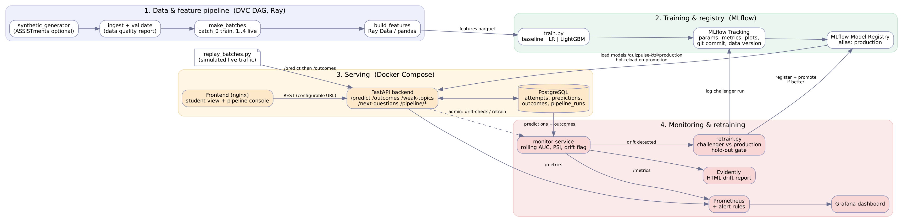

*Figure 1 – System architecture: data pipeline, MLflow tracking and registry, serving, monitoring and retraining loop.*

| Lifecycle stage | Tool | What it does in QuizPulse |
|---|---|---|
| Data engineering | Ray (pandas fallback) | ingest, validation, feature engineering |
| Versioning and CI | Git, DVC, GitHub Actions | 6-stage DVC DAG, `params.yaml`, lint and tests on every push |
| Experiments, registry | MLflow | runs, metrics, artifacts, versions, alias `production` |
| Packaging | MLproject, Docker Compose | identical dev/test environments, 8 containers |
| Serving | FastAPI, MLflow serve, nginx | REST API, MLflow `/invocations`, web UI |
| Monitoring | Prometheus, Grafana, Evidently | live metrics, alerts, drift report |

## 3. Data and feature engineering

We use a synthetic generator that mimics a Sanrathi-style platform (600 students, 12 topics with 25 questions each, 7 weeks, 12 attempts per student per week); the pipeline also accepts the public ASSISTments data. Week 7 contains **injected drift**: three new syllabus topics make up half of the attempts and every question becomes one logit harder. The pipeline ingested 50,454 rows at 140,933 rows/s and the data-quality checks passed.

Rows are split into time-ordered batches: `batch_0` (weeks 1–3) trains the first model, while `batch_1` to `batch_4` are replayed against the API as live traffic. Batch 4 is the drifted one.

Six features are computed from past attempts only: overall accuracy, accuracy on the skill, number of attempts on the skill, accuracy over the last five attempts, hours since the last attempt, and a smoothed question difficulty (plus the skill itself). The **same** function builds features offline for training and online inside the API, which prevents training/serving skew. Unit tests check that a label never leaks into its own features and that offline and online features are identical.

The Ray engine processed 1,350 rows/s on our 8 GB virtual machine; at this data size it is slower than plain pandas, so the CI workflow uses the pandas engine and Ray runs in the main pipeline. On the VM we limit Ray to two CPUs (`RAY_NUM_CPUS=2`) to avoid memory pressure.

## 4. Models and experiment tracking

Three models are trained on the same split of `batch_0` (17,243 training, 4,311 validation and 7,253 test rows, split by time): a baseline that predicts the skill average, logistic regression, and LightGBM (300 trees, learning rate 0.03, 7 leaves). Each run is logged to MLflow with 13 parameters, 7 metrics, tags (`git_commit`, `data_version`), the configuration, the reference feature sample used later for drift detection, and ROC and feature-importance plots. A model can therefore be rebuilt from its commit hash, its data version and its run ID.

| Model | Valid AUC | Test AUC | Test log-loss | Test accuracy | Train time |
|---|---|---|---|---|---|
| Baseline (skill mean) | 0.526 | 0.523 | 0.689 | 0.548 | 0.002 s |
| Logistic regression | 0.758 | 0.762 | 0.582 | 0.690 | 0.053 s |
| **LightGBM** | **0.760** | **0.768** | **0.574** | **0.696** | 0.241 s |

*Table 1 – Initial training results (time-ordered validation and test sets).*

LightGBM wins and is registered as `quizpulse-kt` version 1 with the alias `production`. Registration is blocked unless the best model beats the baseline by 0.02 AUC, so the acceptance criterion is enforced in code (here the margin is more than 0.23).

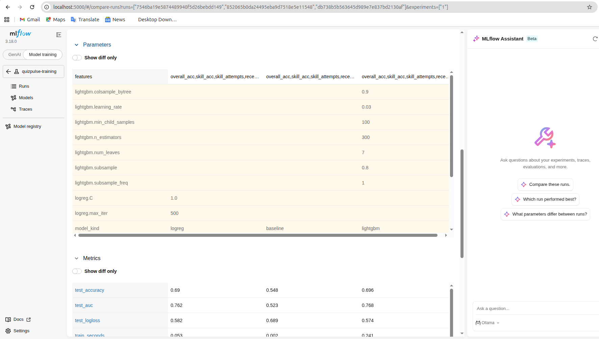

*Figure 2 – MLflow comparison of the baseline, logistic regression and LightGBM runs.*

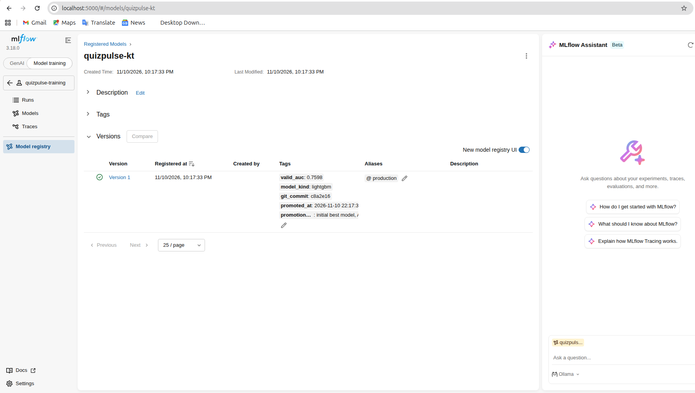

*Figure 3 – MLflow registry: `quizpulse-kt` version 1 with the alias `production` and its tags.*

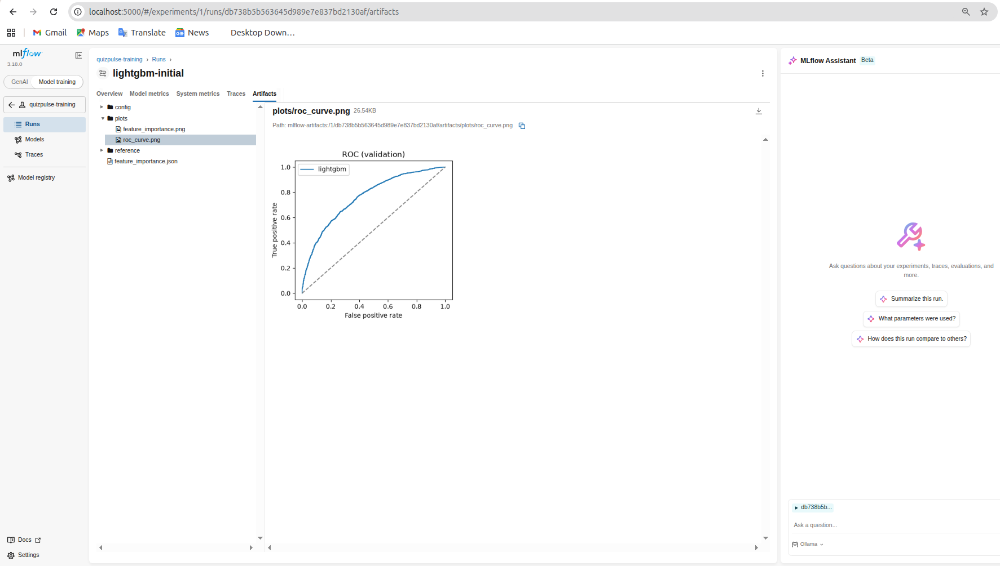

*Figure 4 – ROC curve of the LightGBM run, stored as an MLflow artifact.*

## 5. Serving and user interface

The FastAPI service exposes `POST /predict`, `POST /outcomes`, `GET /students/{id}/weak-topics`, `GET /students/{id}/mastery`, `POST /next-questions`, `GET /health`, `GET /metrics`, `GET /model/info`, the pipeline and monitoring endpoints for the console, and admin calls to reload, check drift and retrain. Request and response bodies are validated with pydantic schemas.

A background thread polls the registry alias every 10 seconds, so a newly promoted model is served without a restart. Topic mastery is the model's average predicted success over a sample of that topic's questions; topics below 50% are marked *weak*. `POST /next-questions` picks questions from the weakest topics that are challenging but doable and returns a plain-language reason for each, which provides a basic form of explainability. The model can also be served directly with `mlflow models serve`; its `/invocations` endpoint rejects inputs with missing columns through MLflow schema enforcement.

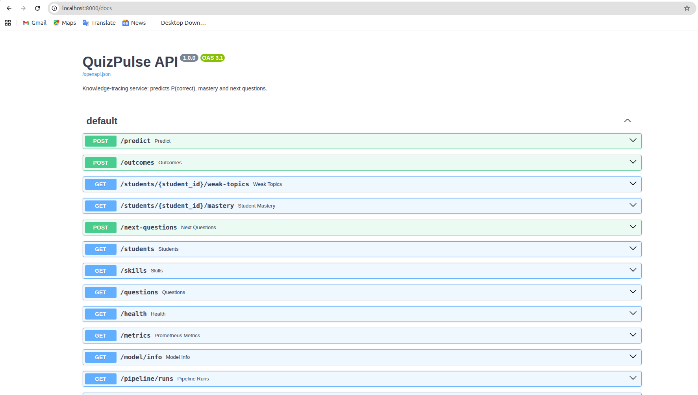

*Figure 5 – Interactive API documentation (Swagger UI) listing every endpoint.*

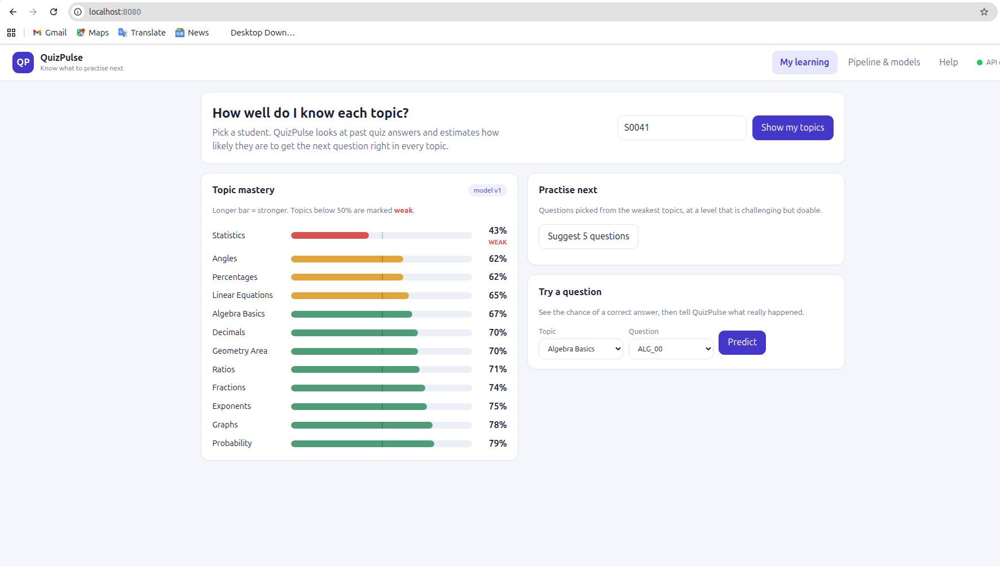

*Figure 6 – Web front end: topic mastery with weak topics highlighted (student S0041).*

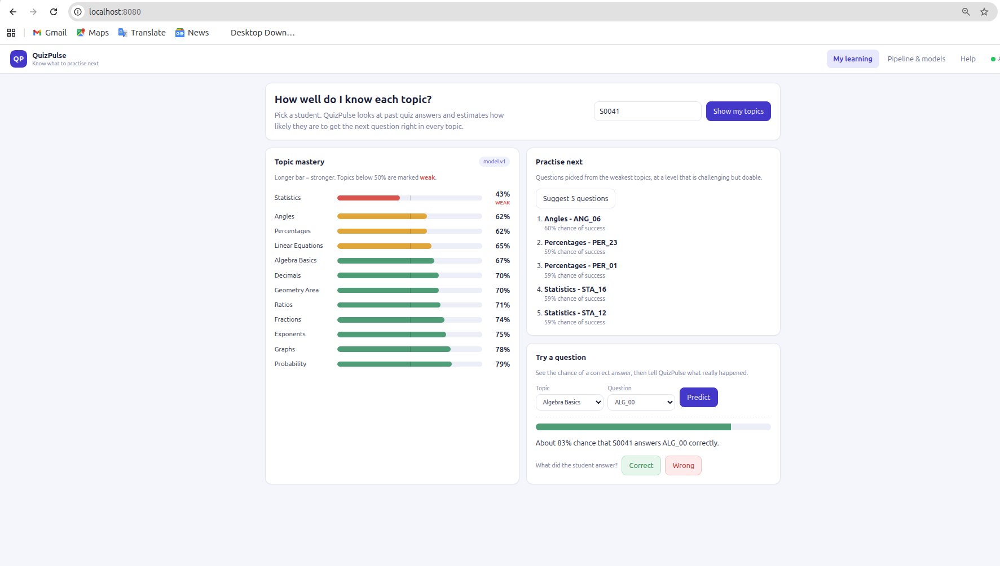

*Figure 7 – "Practise next" suggestions and the "Try a question" gauge.*

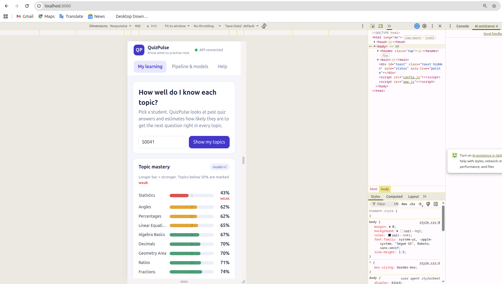

*Figure 8 – Responsive phone-width layout.*

The front end has three tabs: *My learning* for students, *Pipeline & models* for operators, and *Help*, which holds the user manual. The operator console shows the model in use, live AUC, drift status, prediction and label counts, buttons to run a drift check, retrain or reload the model, the pipeline stages with successes and failures, the registry, and a table of recent pipeline runs.

## 6. Monitoring, drift detection and automatic retraining

**Instrumentation.** Prometheus scrapes the API and the monitor. The API exports request counters and latency histograms per endpoint, prediction counts by model version, the distribution of predicted probabilities, feature-build time and the model version; the monitor exports rolling AUC, PSI per feature and the drift flag. Five alert rules are loaded (`ApiDown`, `HighLatencyP95`, `DataDriftDetected`, `RollingAucLow`, `ErrorRateHigh`), and a 15-panel Grafana dashboard refreshes every five seconds for near-real-time viewing.

**Drift decision.** Every 15 seconds the monitor compares the latest 1,500 labelled predictions with the training reference. A feature is drifted if its Population Stability Index (PSI) exceeds 0.2. Drift is declared if at least 30% of the monitored features drift, if the PSI of the predictions exceeds 0.2, or if the rolling AUC falls by more than 0.04. An Evidently report gives a human-readable view. The count of attempts on a skill grows naturally over time, so it is monitored through a stable `cold_start` indicator to avoid false alarms.

**Retrain gate.** On drift, and subject to a five-minute cooldown and at least 500 new labelled rows, the monitor trains a challenger on history plus the new data. The challenger and the production model are scored on the **same** time-ordered hold-out. The challenger is promoted only if AUC improves by at least 0.002 and log-loss does not get worse. Promotion moves the `production` alias, the API hot-reloads, and the monitor's reference window is reset to the new regime.

| Phase | Measured result |
|---|---|
| Normal traffic (batches 1–3, 8,704 labelled outcomes, 0 failed requests) | Rolling AUC 0.781; no drift; largest PSI 0.166 (`skill_acc`), below the 0.2 threshold |
| Drifted batch 4 (2,892 requests, 0 failed) | Rolling AUC fell to 0.712 (drop of 0.043); 2 of 6 features had PSI > 0.2; **DRIFT DETECTED**. The Evidently report flags 5 of 7 columns (71.4%) |
| Automatic retrain (12.0 s) | Challenger trained on 30,285 rows: hold-out AUC 0.7363 vs. 0.7292 for production (+0.0070), log-loss improved by 0.0174 → **promoted to v2** |
| After promotion | `/health` reports model version 2; drift check returns "no drift". The same sequence in Docker gave 0.7280 vs. 0.7232 AUC and promoted v2 again |

*Table 2 – Drift and retraining experiment (local run; repeated successfully in Docker Compose).*

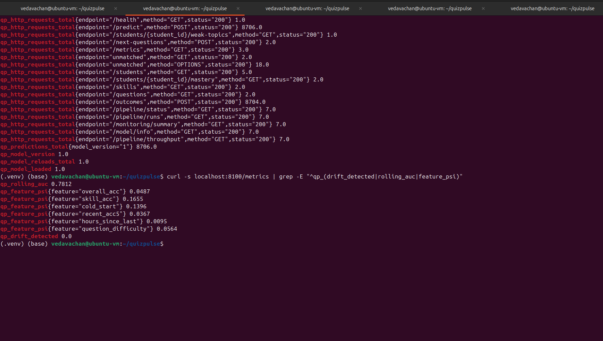

*Figure 9 – Monitor metrics under normal traffic: rolling AUC 0.7812, all PSI values below 0.2, drift = 0.*

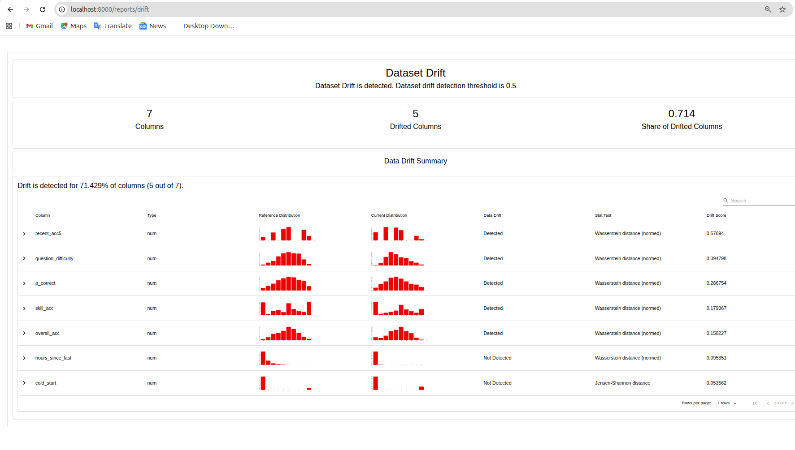

*Figure 10 – Evidently data-drift report for batch 4 (5 of 7 columns drifted).*

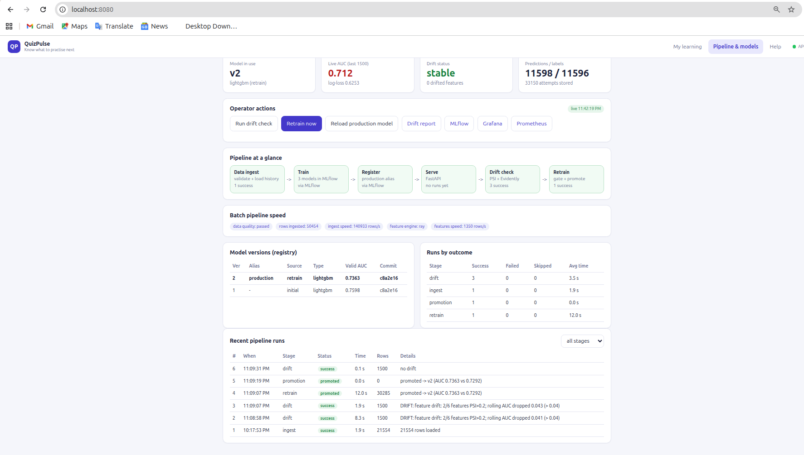

*Figure 11 – Pipeline console after the retrain: drift, retrain and promotion runs, model v2 as production.*

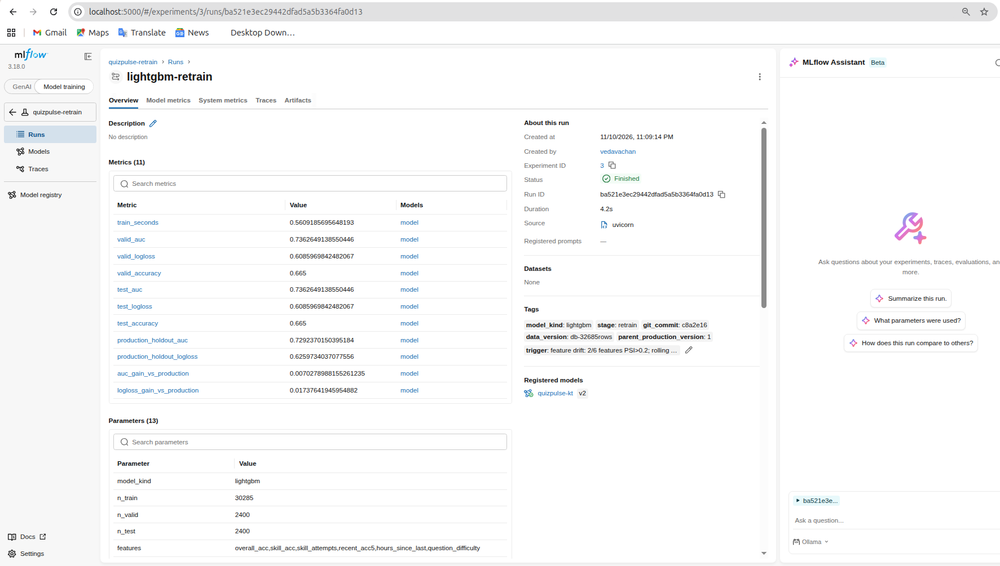

*Figure 12 – MLflow challenger run with the production hold-out AUC and the AUC/log-loss gain that justified promotion.*

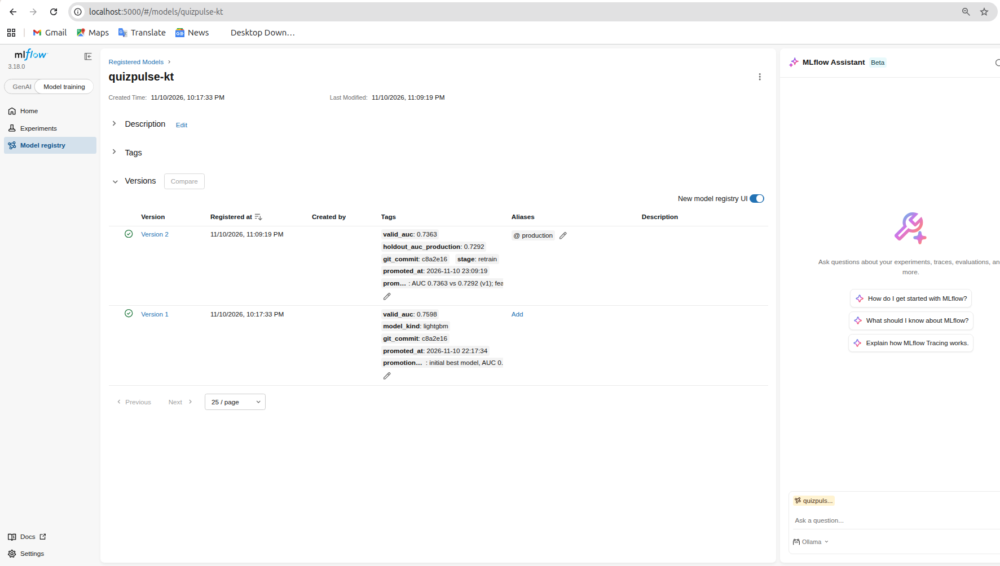

*Figure 13 – MLflow registry after the retrain: v2 holds `production`, with promotion tags recording AUC 0.7363 vs. 0.7292.*

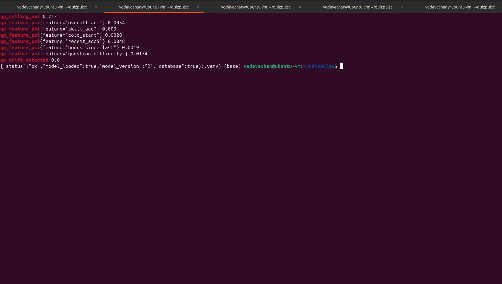

*Figure 14 – `/health` reports `model_version` 2 after the promotion.*

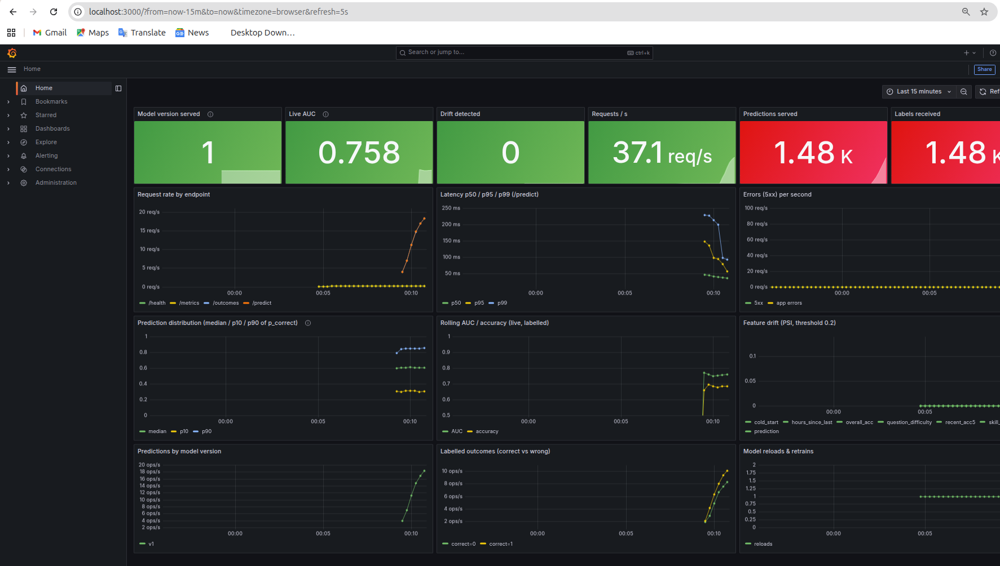

*Figure 15 – Grafana dashboard during live replay: request rate and latency per endpoint, rolling AUC and accuracy, predicted-probability distribution, PSI per feature, labelled outcomes and model reloads.*

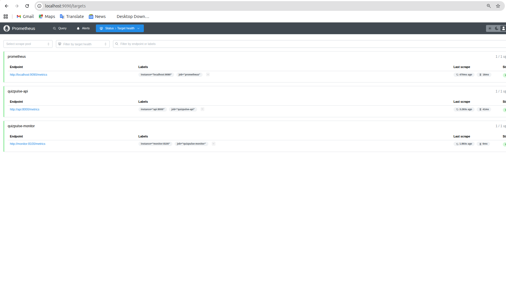

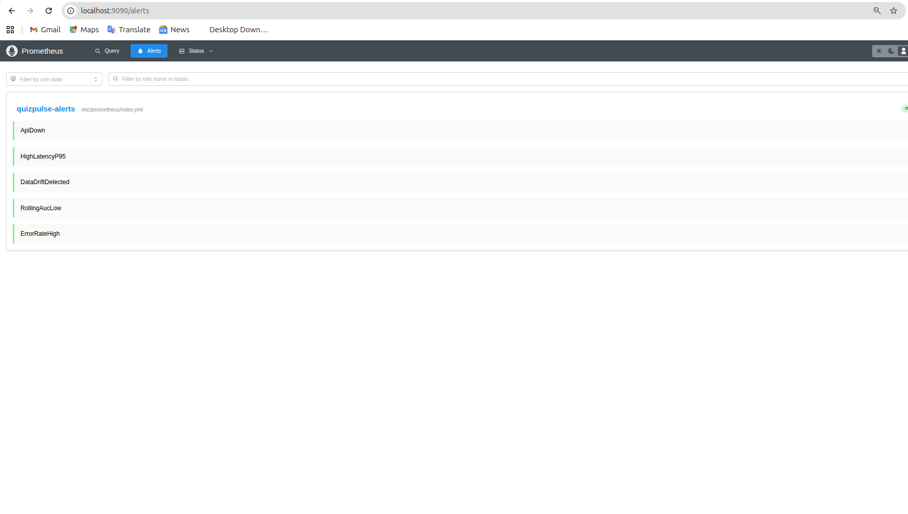

*Figure 16 – Prometheus: the API and monitor targets are up (top) and the five alert rules are loaded (bottom).*

## 7. Software engineering, testing and packaging

The code is organised by responsibility (`common`, `data`, `features`, `models`, `serving`, `monitoring`, `retrain`), uses logging and explicit exception handling, and passes `ruff`. Thirty-two pytest tests cover the API (13), data validation and batching (5), feature correctness, leakage, parity and the Ray/pandas match (5), and metrics, the model wrapper, PSI, drift and the retrain split (9). All 32 pass in about 25 seconds and the JUnit report reads `tests=32, failures=0, errors=0`. The test plan lists the acceptance criteria.

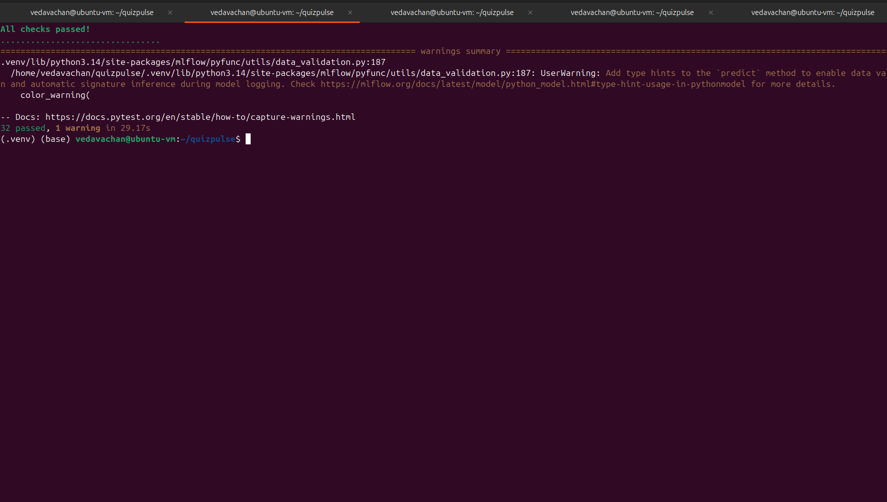

*Figure 17 – `ruff` passes and all 32 tests pass.*

**CI/CD.** The DVC pipeline (`generate` → `ingest` → `batches` → `features` → `train` and `test`) is the project's DAG (`dvc dag`), and `params.yaml` drives every stage so only affected stages re-run. A GitHub Actions workflow runs on every push: lint, tests with a JUnit report, a pandas-engine pipeline run that enforces the AUC acceptance gate, then builds both Docker images and validates the compose file.

**Packaging and rollback.** An MLproject with `python_env.yaml` gives identical environments for `mlflow run`; the backend and front end have separate Dockerfiles; and Docker Compose starts eight services (PostgreSQL, MLflow, a bootstrap job, API, nginx front end, monitor, Prometheus, Grafana). Rollback is a script (`scripts/rollback.py`) that moves the `production` alias back one version (or to a chosen one) and asks the API to reload; we verified v2 → v1 → v2 with `/health` confirming the served version each time, without restarting the API. Documentation comprises the architecture diagram, high- and low-level designs (with endpoint definitions), the test plan and report, and a user manual for non-technical users.

## 8. Coverage of the evaluation criteria

| Criterion | Where it is addressed | Evidence |
|---|---|---|
| Front end UI/UX, user manual | Static web app served by nginx, three tabs, responsive layout, user manual | Figures 6–8 |
| ML pipeline visualization | Operator console: stages, successes and failures, run table, throughput (ingest 140,933 rows/s, features 1,350 rows/s) | Figure 11 |
| Design principles | Architecture diagram, HLD, LLD with endpoint I/O; UI and backend coupled only by REST | Figures 1, 5 |
| Implementation and testing | Logging, exception handling, 32 passing tests, test plan with acceptance criteria and test report | Section 7, Figure 17 |
| Data engineering | Ray feature pipeline with measured throughput, validation checks | Section 3 |
| Source control and CI | Git branches, DVC DAG and parameters, GitHub Actions workflow | Section 7 |
| Experiment tracking | MLflow parameters, metrics, tags, plots and registry | Figures 2–4, Table 1 |
| Prometheus and Grafana | `qp_*` metrics, five alert rules, 15-panel near-real-time dashboard | Figures 15–16 |
| Software packaging | MLflow serve, MLproject, FastAPI, two Dockerfiles, Compose with 8 services | Sections 5, 7 |

## 9. Discussion, limitations and conclusion

**Limitations.** The data is synthetic with drift that we injected on purpose, so absolute numbers will differ on real students. The gain from retraining (+0.007 AUC) is small and is measured on only about 2,400 hold-out rows. The stack runs on one machine, without TLS, authentication or encryption at rest, which the guidelines' "no cloud" rule and a local demo allowed; these would be needed for production. Ray was slower than pandas at this scale. Mastery is a model-based average, so a topic with perfect recent accuracy on a few hard questions can still show a modest mastery value (student S0001, Statistics: 5/5 correct but 35% mastery); this is intended, but it should be explained to users.

**Conclusion.** QuizPulse delivers every stage of the required lifecycle in a reproducible, containerised system: versioned data and code, tracked experiments, a decoupled API and UI, live monitoring with alerts, drift detection, a gated automatic retrain-and-promote loop and a tested rollback. In our runs the best model reached 0.768 test AUC against 0.523 for the baseline, drift lowered live AUC from 0.781 to 0.712, and the automatic retrain promoted a better model without manual steps or downtime.

## Reproduce

```bash
dvc repro                                   # data -> features -> train -> tests
docker compose up --build                   # full stack: API, UI, MLflow, Prometheus, Grafana
python scripts/replay_batches.py --batch 1 2 3 --student-fraction 0.4   # normal traffic
python scripts/replay_batches.py --batch 4 --student-fraction 0.4       # drifted traffic
python scripts/rollback.py                  # move `production` back one version
```
